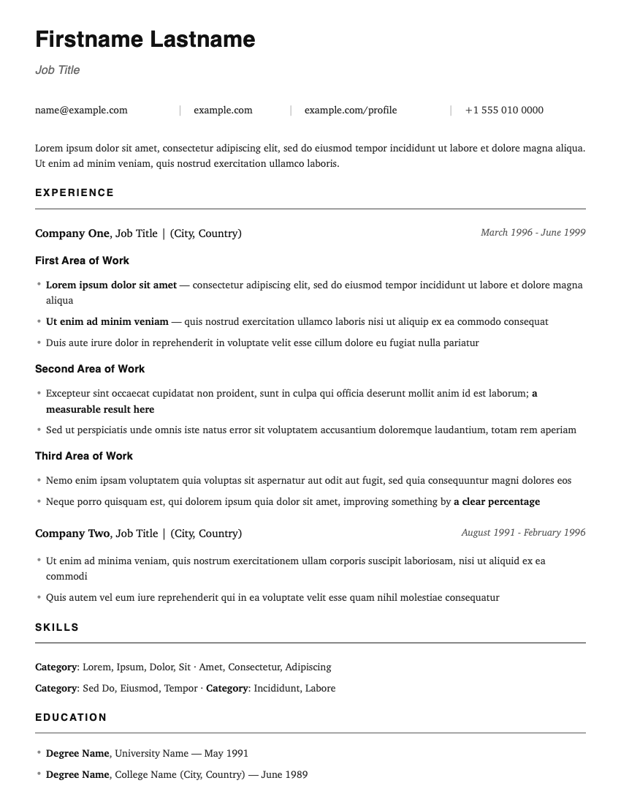

# ResumeKit

Write a clean, **one-page** resume in a plain text file and turn it into a PDF with one command.



## Quick start

You'll type a few commands into **Terminal** (on a Mac: press `⌘ Space`, type "Terminal", press Enter).

**1. Get the kit**, then go into its folder:

```bash
git clone https://github.com/mikhaidn/ResumeKit.git
cd ResumeKit
```

**2. Install what it needs** (one time only, takes a few minutes):

```bash
make setup
```

> On a Mac, if you're asked to install "command line developer tools", click **Install**, then run `make setup` again.
> The setup uses [Homebrew](https://brew.sh) on a Mac — install that first if you don't have it.

**3. Create your resume file:**

```bash
make start
```

This makes `private/resume.md`, a copy of the example. The `private` folder is never uploaded or shared, so your phone number and email stay on your computer.

**4. Edit it.** Open `private/resume.md` in any text editor (TextEdit, Notepad, VS Code…) and replace the placeholder text with your own.

**5. Build your PDF:**

```bash
make resume
```

Your PDF opens automatically. It's saved as `private/resume.pdf`, with a dated backup copy in the `output/` folder.

Repeat steps 4 and 5 until you're happy. If your resume grows past one page, `make resume` will warn you.

## Editing your resume

The file uses [Markdown](https://www.markdownguide.org/basic-syntax/), a simple way to format plain text. You mostly just need to follow the patterns already in the example:

| You want…              | Write this                                   |
| ---------------------- | -------------------------------------------- |
| **Bold** text          | `**bold text**`                              |
| A bullet point         | `- your bullet`                              |
| A section (Skills…)    | The title, then a line of `---------` below  |
| A sub-heading in a job | `* **Area of Work**`, then bullets indented by 2 spaces |

**Jobs** (company on the left, dates on the right) use the dashed-line blocks in the example. To add one, copy an existing block and change the words — the dashes don't need to line up exactly.

**Contact line**: replace the email, links and phone number, keeping the `|` separators.

Keep bold for things you want a reader to spot while skimming (numbers, key results) — bolding whole sentences makes everything look equally important.

## Fit on one page

You don't have to fiddle with spacing: every build automatically stretches or squeezes the gaps between lines and sections so your resume fills exactly one page. A short resume gets airy; a long one gets tightened.

If `make resume` still warns that you're over one page, you have more than fits even at the tightest spacing. Try in this order:

1. Cut your weakest bullet. (Almost always the best fix.)
2. Shorten long bullets that wrap onto a second line by only a word or two.
3. Shrink the `@page` margin in `resume.css` (try `0.3in 0.45in`).

Prefer fixed spacing? Run `FILL=1 ./build.sh private/resume.md` to use `resume.css` exactly as written.

**Want a deliberate second page?** (e.g. a detailed skills/keyword page for applicant tracking systems) Put this line in your `.md` where page 2 should start:

```html
<div class="page-break"></div>
```

Each page break adds one page to the target, so spacing is still tuned to fill the pages exactly.

## Customizing the look

All styling is in `resume.css`. Common changes:

- **Font**: change the `font-family` line — e.g. `"EB Garamond", "Garamond", serif` for traditional, or `"Inter", "Helvetica", sans-serif` for modern.
- **Size**: change `font-size` (default `10pt`).
- **Per-resume theme**: put a CSS file next to your resume with the same name (e.g. `private/resume.css` for `private/resume.md`). It's layered on top of `resume.css`, so you only write the rules you want to change.

## All commands

| Command        | What it does                                          |
| -------------- | ----------------------------------------------------- |
| `make setup`   | Install everything needed (one time)                  |
| `make start`   | Create `private/resume.md` from the example           |
| `make resume`  | Build your PDF and open it                            |
| `make example` | Build the example `resume.pdf`                        |
| `make clean`   | Delete generated PDFs (never touches your `.md` files) |

Want several versions (e.g. one per job type)? Put more `.md` files in `private/` and build them with `./build.sh private/other.md`.

## Troubleshooting

**`make: command not found`** (Mac): run `xcode-select --install`, click Install, then try again.

**`pandoc not installed` / `weasyprint not installed`**: run `make setup`.

**Bullets or sub-headings look wrong**: sub-headings must be `* **Title**` (star, space, bold title) and the bullets under them must start with exactly 2 spaces then `- `.

**Something else looks off**: open `private/resume.html` in a web browser — it's the same resume as a web page, which makes it easy to spot what's wrong.

**"Ignored gap" warnings**: harmless, ignore them.

## How it works

[pandoc](https://pandoc.org) turns your Markdown into a web page styled by `resume.css`, then [WeasyPrint](https://weasyprint.org) prints that page to PDF. `build.sh` does both steps; the `Makefile` just wraps it with setup and friendly names.

## Credits

Inspired by [mszep/pandoc_resume](https://github.com/mszep/pandoc_resume), which I first used about a decade ago.

**AI disclosure:** much of this kit's code and documentation (build script, Makefile, CSS, and this README) was AI-generated, then reviewed by me — I use this tool for my own resume. Any resemblance to existing CSS or Markdown templates likely comes via the model's training data — if you recognize your work here, please open an issue and I'll add credit.

## License

[MIT](LICENSE). Portions inspired by or adapted from pandoc_resume are © 2014 Mark Szepieniec, also under the MIT License.
